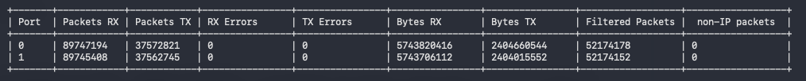
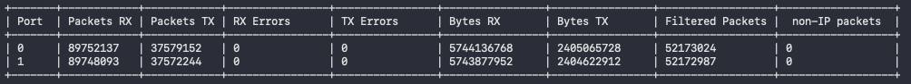

# DPDK Forwarding Application

## How to Build

### Install Dependencies
```bash
sudo apt update
sudo apt install -y build-essential cmake
sudo apt install -y pkg-config
```

### Install DPDK
```bash
wget -q https://fast.dpdk.org/rel/dpdk-25.11.4.tar.xz -O dpdk.tar.xz
mkdir -p /opt/dpdk
tar xf dpdk.tar.xz -C /opt/dpdk
cd /opt/dpdk
meson setup build \
  -Dc_args="-O3 -march=znver4 -mtune=znver4" \
  -Dcpu_instruction_set=znver4
cd build
ninja
meson install
ldconfig
```

### Build the Project
```bash
cd "path to project dpdk_forward"
# For Release
cmake -DCMAKE_BUILD_TYPE=Release -B build

# For Debug
cmake -DCMAKE_BUILD_TYPE=Debug -B build

# Build
cmake --build build
```

---

## Kernel Settings

Add the following to your kernel boot parameters:
```
amd_iommu=on iommu=pt iommu.passthrough=1 isolcpus=0-31 default_hugepagesz=1G hugepagesz=1GB hugepages=32
```

After updating, run:
```bash
sudo update-grub
sudo reboot
```

---

## How to Run

```bash
sudo ./build/dpdk_forward -l 0-63 \
  -a 0000:44:00.0,mprq_en=1,rxqs_min_mprq=1,rxq_cqe_comp_en=1,txq_mpw_en=1,rxq_pkt_pad_en=1,txq_inline_max=1024,txq_inline_mpw=1024,txqs_min_inline=1 \
  -a 0000:44:00.1,mprq_en=1,rxqs_min_mprq=1,rxq_cqe_comp_en=1,txq_mpw_en=1,rxq_pkt_pad_en=1,txq_inline_max=1024,txq_inline_mpw=1024,txqs_min_inline=1 --
```

**Where:**

0000:44:00.0 and 0000:44:00.1 are NIC PCI BDF addresses.

**DPDK options**

mprq_en=1: Enables Multi-Packet Receive Queue (MPRQ) for better RX efficiency.

rxqs_min_mprq=1: Activates MPRQ if at least one RX queue is present.

rxq_cqe_comp_en=1: Enables compression of Completion Queue Entries (CQEs) to reduce PCIe bandwidth usage.

txq_mpw_en=1: Enables Multi-Packet Write (MPW) for TX queues to improve TX throughput.

rxq_pkt_pad_en=1: Adds padding to received packets to align with cache lines.

txq_inline_max=1024: Inlines up to 1024 bytes into TX WQEs.

txq_inline_mpw=1024: Sets the maximum inline size for MPW TX WQEs.

txqs_min_inline=1: Enables inlining if at least one TX queue is present.

---

## Dependencies
DPDK
POSIX Threads
CMake
C Compiler
---

## How to Verify the Program is Working

To verify functionality, the best approach is to write tests using real data captured from a router and confirm that the necessary packets are dropped and MAC addresses are replaced where needed.
In this project, external driver statistics are used as an independent verification method.
Additionally, the monitoring statistics include a counter for filtered packets, which should be approximately half of the total packet count.

---

## Brief Performance Report

Measured with two 100G ports, 64-byte packets, 8 RX + 8 TX cores per port:
- **~90M pps per port in (~180M pps total)**, ~37.5M pps per port out after filtering (~58% of the traffic is dropped by the filter table)
- at this rate occasional RX errors appear; at **~87M pps per port** and below they disappear completely (0 RX / TX errors — no packets lost in the NIC, the RX/TX rings or the TX buffers)
- with large packets: **200G bps** (200 in, 100 out)




Screen recording of the run: [images/forwarder-run.mov](images/forwarder-run.mov)

---

## Algorithm Overview

1. After receiving a packet, a hash based on a 2-tuple (IP destination and IP source) is calculated to distribute packets across different queues.
This reduces synchronization issues between threads. Each queue ideally processes a unique 2-tuple set.

2. RX queue is read and packets are parsed and processed in one thread. TX queue is handled by another thread.

3. Processing includes parsing and checking what actions need to be taken, using hash tables.

4. First, the IP source address is checked in a Filter table. If present, it marks the packet as illegal and the packet is dropped (not placed into TX queue).
Currently, about half of the IP source addresses from pktgen are inserted into this table, so roughly half the traffic is dropped.

5. A second table holds information on what MAC address should replace the packet’s destination MAC.
If the destination IP is found in the table, the MAC is replaced with the stored one. Otherwise, a default MAC address is set.
This table works like a "set" structure with custom hash and stores MAC addresses directly in the key.
It is also possible to add 2-tuple statistics without synchronization issues.
---

## Notes and Possible Improvements

RX and TX queues are handled on different cores, as required by the task, but this added complexity without noticeable performance gains.

Logging is implemented manually. It would be better to use a proper logging library like Boost.Log.

Only IPv4 is supported.

Prefetching is partially implemented. Full cache miss analysis using perf is needed, and proper prefetching should be added based on the findings.

No unit tests are currently implemented.

Compilation is optimized for a specific CPU (znver4).

A simple rate limiter should be added to control packet forwarding speed.

Flow rules and hardware offloading are not used. Based on experience, hardware offloads do not always work reliably and rarely give big performance benefits.
